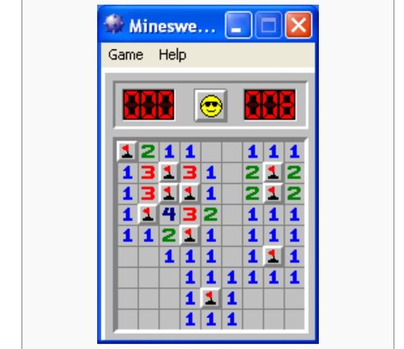

# Minesweeper

Have you ever played **Minesweeper**? 

It’s a cute little game which comes within a certain Operating System whose name we can’t really remember. 



Well, the goal of the game is to find all the mines within an field. 

## How it works

To help you find all the mines, the game shows a number in a cell which tells you how many mines there are adjacent to that cell. 

You can then flag a cell if you think there is a mine under it, or reveal one if you think there isn't (or don't know haha) to see which number actually lies under.

## Run

```bash
cargo run
```

A field will automatically be square, so only the side length input is needed.

Coordinate input should be formatted as `row n° [space] column n°`. 

Add `F` after the coordinates if you want to flag the cell

For example : `0 0`, `2 4`, or `3 1 F` 

## Example

```text
Enter a side length for the mine field :
4
     0 1 2 3 
     ———————
0  | . . . . 
1  | . . . . 
2  | . . . . 
3  | . . . . 

Enter a set of coordinates :
0 0
     0 1 2 3 
     ———————
0  |   1 . . 
1  |   1 . . 
2  |   1 2 2 
3  |         

Enter a set of coordinates :
1 2 F
     0 1 2 3 
     ———————
0  |   1 . . 
1  |   1 x . 
2  |   1 2 2 
3  |         

Enter a set of coordinates :
0 2
     0 1 2 3 
     ———————
0  |   1 2 . 
1  |   1 x . 
2  |   1 2 2 
3  |         

Enter a set of coordinates :
1 3 F
     0 1 2 3 
     ———————
0  |   1 2 . 
1  |   1 x x 
2  |   1 2 2 
3  |         

You did it ! All mines were succesfully flagged :D
```
